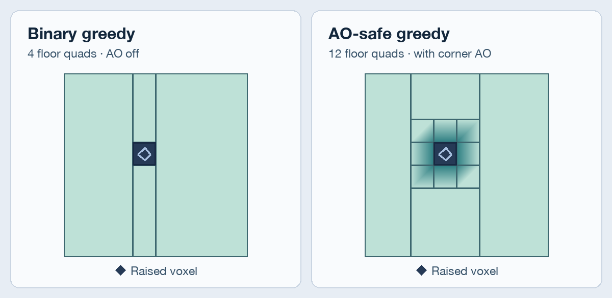

# block-mesh-bgm

[](https://crates.io/crates/block-mesh-bgm)
[](https://docs.rs/block-mesh-bgm)

**Binary greedy meshing for `block-mesh`, with AO-safe merging.** It replaces the meshers and nothing else: keep your voxel data and quad types. On the [smooth-hills benchmark](#benchmarks), binary greedy meshing was about **13× as fast** as `block_mesh::greedy_quads`.

The AO-safe mesher uses occupancy masks to find where opaque faces can merge while preserving per-vertex ambient occlusion (AO). You can then sample AO once per opaque quad. On the layered-caves benchmark, AO-safe meshing took **29% less time** than plain binary greedy meshing.

[From block-mesh](#switch-from-block-mesh) · [Quick start](#mesh-your-first-chunk) · [AO-safe merging](#ao-safe-not-ao-baked) · [From other binary meshers](#coming-from-binary-greedy-meshing) · [Benchmarks](#benchmarks)

## Switch from `block-mesh`

| What you need | Mesher | Output buffer |
| --- | --- | --- |
| Replace `greedy_quads` | `binary_greedy_quads` | `BinaryGreedyQuadsBuffer` |
| Preserve vertex AO on opaque surfaces | `binary_greedy_quads_ao_safe` | `BinaryGreedyQuadsBuffer` |
| Replace `visible_block_faces` | `binary_visible_block_faces` | `BinaryUnitQuadBuffer` |

Pass the same voxels, shape, bounds, and face config. The mesher builds its masks directly from your voxel slice. Create the new buffer with `new()` and reuse one per worker.

- **Face coverage stays the same.** Quad layout, count, and order can differ.
- **Every call clears the output.** If you relied on upstream `visible_block_faces` appending, collect the quads after each call.
- **Queries tile automatically beyond 62 interior voxels on any axis.** Tiles read neighboring voxels for visibility and AO. Quads stop at tile seams.

Pair each group in `buffer.quads` with its entry in `faces` to use the existing [`OrientedBlockFace`](https://docs.rs/block-mesh/latest/block_mesh/struct.OrientedBlockFace.html) vertex helpers.

## Mesh your first chunk

In a Rust binary project, run `cargo add block-mesh@0.2 block-mesh-bgm@0.2`. Save this as `src/main.rs` and run `cargo run`. Expect `6 quads`. For voxel traits, shapes, and padding, see the [`block-mesh` docs](https://docs.rs/block-mesh/latest/block_mesh/).

```rust
use block_mesh::ndshape::{ConstShape, ConstShape3u32};
use block_mesh::{MergeVoxel, Voxel, VoxelVisibility, RIGHT_HANDED_Y_UP_CONFIG};
use block_mesh_bgm::{binary_greedy_quads, BinaryGreedyQuadsBuffer};

#[derive(Clone, Copy)]
struct Block(u8);

impl Voxel for Block {
    fn get_visibility(&self) -> VoxelVisibility {
        if self.0 == 0 {
            VoxelVisibility::Empty
        } else {
            VoxelVisibility::Opaque
        }
    }
}

impl MergeVoxel for Block {
    type MergeValue = u8;

    fn merge_value(&self) -> u8 {
        self.0
    }
}

fn main() {
    // 0 is air. The two blocks share material 1.
    type Chunk = ConstShape3u32<4, 4, 4>;
    let mut voxels = [Block(0); Chunk::SIZE as usize];
    voxels[Chunk::linearize([1, 1, 1]) as usize] = Block(1);
    voxels[Chunk::linearize([2, 1, 1]) as usize] = Block(1);

    let faces = RIGHT_HANDED_Y_UP_CONFIG.faces;
    let mut buffer = BinaryGreedyQuadsBuffer::new();
    binary_greedy_quads(&voxels, &Chunk {}, [0; 3], [3; 3], &faces, &mut buffer);

    println!("{} quads", buffer.quads.num_quads());
}
```

Change the second block to `Block(2)` to see the same shape take **10 quads** across two materials.

## AO-safe, not AO-baked

A merged quad shades only its four corners, so merging across an AO change smears the darkening. Binary greedy meshers have usually paid for AO in meshing time or dropped it: baking AO roughly doubled meshing time on cgerikj's [v1 sphere benchmark](https://github.com/cgerikj/binary-greedy-meshing/tree/v1.0.0#benchmarks), the [v2 README](https://github.com/cgerikj/binary-greedy-meshing) points back to v1 for it, and Inspirateur cites meshing cost in the Rust port's [open AO discussion](https://github.com/Inspirateur/binary-greedy-meshing/issues/2).

`binary_greedy_quads_ao_safe` doesn't bake AO. It derives merge limits for a whole row of opaque faces from occupancy masks. It emits unit faces directly, uses simpler merge paths for faces that can join along one axis, and runs the full greedy merge on the rest. This skips per-face AO signatures and leaves the four corner values to a single sample per output quad.



Each unit face in a merged opaque quad has the same four corner values in the same order. Sample at `quad.minimum` and count only opaque voxels as occluders. Translucent faces follow the ordinary greedy merge rules. See [`FaceAoSampler`](https://docs.rs/block-mesh-bgm/latest/block_mesh_bgm/struct.FaceAoSampler.html) for the details.

Paste this inside `main` after the quick start's `println!` to check for shading around a raised block.

```rust
use block_mesh_bgm::{binary_greedy_quads_ao_safe, FaceAoSampler};

voxels[Chunk::linearize([2, 2, 1]) as usize] = Block(1);
binary_greedy_quads_ao_safe(&voxels, &Chunk {}, [0; 3], [3; 3], &faces, &mut buffer);

let mut shaded = false;
for (group, face) in buffer.quads.groups.iter().zip(faces) {
    let sampler = FaceAoSampler::for_shape(face, &Chunk {});
    for quad in group {
        let ao = sampler.sample(&voxels, quad.minimum, |voxel| {
            voxel.get_visibility() == VoxelVisibility::Opaque
        });
        // One value per vertex, from 0 (dark) to 3 (open).
        shaded |= ao.iter().any(|&value| value < 3);
    }
}
assert!(shaded);
```

From a checkout, run the demo and press **A** to watch the shading and quad count change.

```sh
cargo run --release -p block-mesh-bgm-examples --example ambient_occlusion
```

## Coming from binary-greedy-meshing

This crate builds on the bitmask approach from [cgerikj's binary greedy mesher](https://github.com/cgerikj/binary-greedy-meshing) and Inspirateur's [Rust port](https://github.com/Inspirateur/binary-greedy-meshing). Like them, it packs occupancy into `u64` masks, culls 64 faces at a time, and only looks up voxel types where the masks say a merge is possible. What changes:

| | cgerikj v2 | `binary-greedy-meshing` | `block-mesh-bgm` |
| --- | --- | --- | --- |
| Voxels | Padded voxel array | Padded `u16` array in ZXY order | Your voxel type and `block-mesh` shape |
| Interior size | `62³` | Cubic, up to 62 voxels per axis at compile time | Rectangular runtime bounds, tiled above 62 voxels per axis |
| Visibility | Caller supplies an opaque occupancy mask | `mesh` takes transparent voxel IDs. `fast_mesh` takes opaque and transparent masks | Reads `VoxelVisibility` from your voxels |
| Ambient occlusion | Baked AO in [v1](https://github.com/cgerikj/binary-greedy-meshing/tree/v1.0.0) only | [Open feature request](https://github.com/Inspirateur/binary-greedy-meshing/issues/2) | AO-safe merging with a per-quad sampler |
| Output | Packed quads for vertex pulling | `Quad(u64)` | `block-mesh` quads |

If you render with vertex pulling, pack each `UnorientedQuad` into your own format after meshing.

## Benchmarks

Criterion medians on an Apple M4 with reused buffers. Timings cover meshing and exclude AO sampling and vertex generation.

| Scene | `greedy_quads` | Binary greedy | AO-safe greedy |
| --- | ---: | ---: | ---: |
| Dense sphere · one `34³` padded chunk | 250 µs | 21 µs | 24 µs |
| Smooth hills · four chunks | 887 µs | 70 µs | 92 µs |
| Layered caves · eight chunks | 3.77 ms | 304 µs | 216 µs |
| Large model · one `130×66×98` padded query | 9.39 ms | 1.03 ms | 1.03 ms |

On the hills, upstream `visible_block_faces` took 139 µs and `binary_visible_block_faces` took 60 µs. AO-safe meshing took 31% longer than plain binary greedy on the hills and 29% less time in the caves, where more faces used the simpler merge paths.

Run `cargo bench --bench bench` for the full suite. Add `-- smooth-hills` to focus on the hills. The table used 50 samples, a 1-second warm-up, and a 2-second measurement target per case.

## More examples

From a checkout, run `cargo run --release -p block-mesh-bgm-examples --example <name>`. The demos use Bevy 0.20, which needs Rust 1.97.1 or newer.

| Demo | What to try |
| --- | --- |
| [`render`](examples_crate/render/main.rs) | Compare quad counts across meshers. Press **Space** to toggle wireframes and **T** to change scenes. |
| [`ambient_occlusion`](examples_crate/ambient_occlusion/main.rs) | Press **U** to compare with unit faces and **S** to swap the sphere for a torus. |
| [`custom_meshing`](examples_crate/custom_meshing/main.rs) | Watch chunk rebuild timings as the camera flies through a `bevy_voxel_world` scene. Press **1**–**4** to switch meshers, including `bevy_voxel_world`'s built-in one, and **A** to toggle AO. |

## License

[MIT](LICENSE.MIT) or [Apache-2.0](LICENSE.Apache-2.0), at your option.
